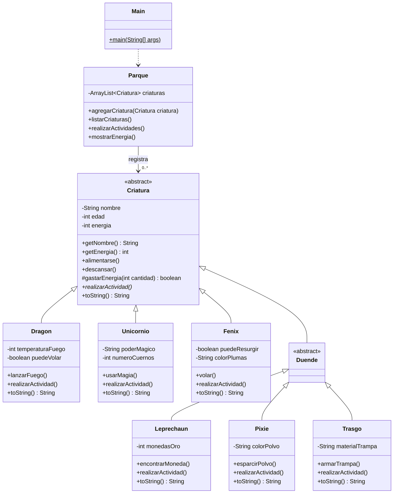

Diagrama de clases UML



`Criatura` reúne los atributos y comportamientos comunes. `Parque` guarda las criaturas en una lista y llama a `realizarActividad()` para que cada una haga la actividad que le corresponde.


 Cómo ejecutar

Desde la carpeta `parque-criaturas`, con el JDK instalado, ejecuta en PowerShell:

```powershell
$fuentes = (Get-ChildItem src -Filter *.java).FullName
javac -encoding UTF-8 -d salida $fuentes
java -cp salida Main
```

Reflexión

¿Qué dificultades encontró en la realización de esta actividad y en la de preparación y que deba reforzar?

R// no se me resulto muy dificil en esta actividad porque en el proceso de la hackaton me toco estudiar bastante sobre estos temas y se me facilito mucho

R// debo reforzar todavia en los constructores y en las llamadas de las clases para las herencias


¿qué se le facilitó o cuáles considera que son sus fortalezas durante la realización de los ejercicios?

R//se me facilito que ya puedo entender el codigo y ya tengo la estructura en la cabeza para poder armarlo antes de programar

R//mis fortalezas son el razonamiento y la estructuracion de algoritmo y que ya me se las bases
